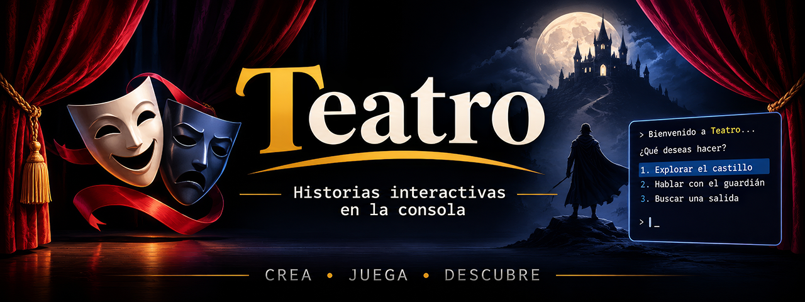

<!-- Portadas: recursos/portada.png (1280x480) y recursos/portada-2x.jpeg (4096x1536, alta resolucion) -->
<p align="center">
  
</p>

<h1 align="center">Teatro</h1>

<p align="center">
  <strong>Motor de ficción interactiva y aventuras conversacionales para consola.</strong><br>
  Escrito en <a href="https://github.com/FrkL81/Latino.NET">Latino.NET</a> sobre .NET 10.
</p>

---

## Presentación

**Teatro** es un motor para crear videojuegos de texto interactivo, inspirado en Twine, diseñado para ejecutarse en la consola. Cada historia se desarrolla a través de **escenas** que incluyen un título, una descripción y un conjunto de opciones que el jugador elige; el nombre *Teatro* refleja ese enfoque: las historias se representan como obras teatrales, donde cada escena abre un nuevo acto y las decisiones del jugador marcan el rumbo de la obra.

## Crédito y licencia

Este repositorio es una **modernización** del proyecto original creado por **[@lukeitorld](https://github.com/lukeitorld)** (v0.1–v0.5, escrito en Latino clásico). Se preserva íntegramente la **licencia MIT** y el reconocimiento al autor original de la idea y de la arquitectura de escenas.

La v0.6 migra el motor a Latino.NET, corrige los problemas de diseño heredados y adapta los ejemplos.

## El motor: Latino.NET

Teatro v0.6 corre sobre **[Latino.NET](https://github.com/FrkL81/Latino.NET)**, el sucesor moderno del lenguaje, que ejecuta sobre **.NET 10** con una arquitectura de **objetos reales** (POO con `clase ... fin`, constructores en cascada y pronombres de concordancia `mi` / `este` / `esta`).

Dos cambios de modelo importan al usar el módulo:

- `incluir("teatro")` **no retorna valor** (inyecta el código en el entorno global). La instancia la crea la *fábrica*.
- El estado del motor es **privado** (`local` dentro de la fábrica) y solo se accede por la interfaz devuelta.

## Guía rápida

```latino
incluir("teatro")          # cargar el modulo (desde la raiz del proyecto)
teatro = CrearTeatro()     # crear la instancia
```

Configuración opcional:

```latino
teatro = CrearTeatro()                 # ancho de consola por defecto: 100
teatro = CrearTeatro({"ancho": 60})    # ancho personalizado
```

Bucle típico de juego:

```latino
teatro.cambiar_escena(menu)
mientras (jugando)
    teatro.procesar_entrada(leer())
fin
```

> **Nota de ruta:** `incluir()` resuelve las rutas relativas al **directorio del script de entrada** (el archivo que se pasa a `latino`). Si tu juego vive en una subcarpeta, incluye el motor con `incluir("../teatro")`. Así lo hacen los ejemplos de este repositorio.

## Estructura de una escena

Una escena es un **diccionario de 4 elementos**:

| Clave | Tipo | Uso |
|---|---|---|
| `nombre` | cadena | Título de la escena, centrado entre bordes `=` |
| `descripcion` | cadena | Cuerpo; se ajusta al ancho configurado, respetando palabras y párrafos |
| `id` | decimal | Identificador corto de la escena |
| `opciones` | lista de cadenas | Las decisiones del jugador |

Cada opción es `Texto visible >comando<`: el comando (entre `>` y `<`) se ejecuta al elegir la opción, y `>vacio<` la oculta.

```latino
menu = {
    "nombre": "Menú Principal",
    "descripcion": "Bienvenido.",
    "id": 0,
    "opciones": ["Saber más >teatro.cambiar_escena(manual)<", "Oculta >vacio<", "Salir >teatro.cambiar_escena(salida)<"]
}
```

## Ejemplos

```bash
latino ejemplos/ejemploMinimo.lat
latino ejemplos/ejemploDosEscenas.lat
```

## Interfaz pública

| Miembro | Descripción |
|---|---|
| `teatro.estado` | Estado del motor (`configuracion`, `historia`, `escena_actual`, `escena_anterior`) |
| `teatro.cambiar_escena(escena)` | Carga y renderiza una escena |
| `teatro.procesar_entrada(entrada)` | Valida (`"1"`, `"2"`, `"3"`) y despacha la opción elegida |
| `teatro.procesar_opcion(opcion)` | Ejecuta el comando embebido en una opción |
| `teatro.armar_cuerpo(texto)` | Ajusta el texto al ancho, por palabras |
| `teatro.centrar_encabezado(titulo)` | Centra el título entre bordes `=` |

## Roadmap

- **V 0.50** — Versión final para consola (Latino clásico). ✅
- **V 0.60** — Migración a Latino.NET: patrón *Factory*, estado encapsulado, ajuste de texto por palabras y validación exacta de entradas. ✅
- **V 0.61** — Portada gráfica (`recursos/portada.png`) y metadatos del repositorio. ✅
- **V 0.51~1.00** — Versión con ventana gráfica (GTK / Avalonia).

---

*Licencia MIT · Diseño original: [@lukeitorld](https://github.com/lukeitorld) · Motor: [Latino.NET](https://github.com/FrkL81/Latino.NET)*
